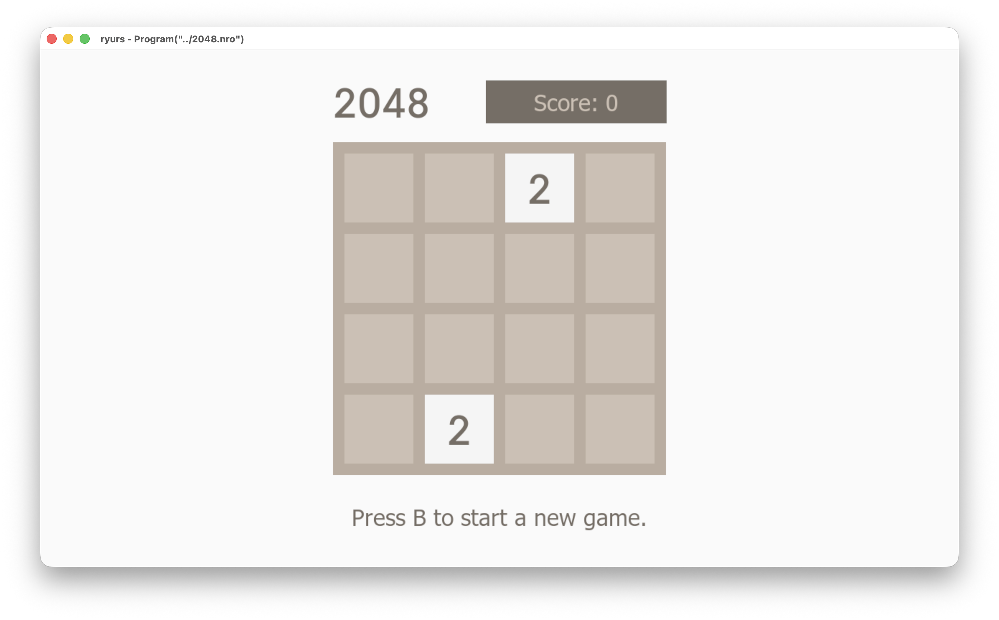

# ryurs

Still in WIP and under heavily development.

Use the following command

`cargo run --release -p ryurs-cli -- --program 2048.nro --display`

to run the 2048 game.
Please note that user inputs are not supported yet (keyboards, mouse, controllers etc.).

2048: https://github.com/BernardoGiordano/2048/releases

> [!IMPORTANT]
> Due to a cranelift bug [#12697](https://github.com/bytecodealliance/wasmtime/pull/12697) on AArch64 backend and I'm using ARM macOS for development, `Cargo.toml` is using a customized cranelift fork.
> This should be fixed in the next `cranelift` release.

## License

This project is dual-licensed under the **MIT License** and the **Apache License 2.0**. 
You may choose either license for your usage.

## Credits

Special thanks to the `Ryujinx` and `libnx` team for their incredible work on emulation, which served as the primary development and testing environment for this project.